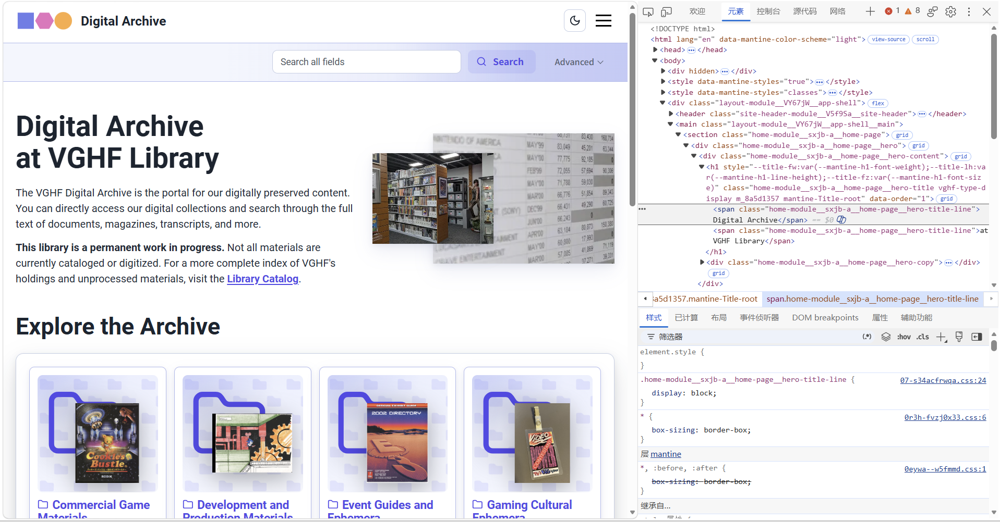

# Source & Style Assignment

## Assignment 1: Inspecting the Cultural Web

### Selected Website

For this assignment, I chose the **Video Game History Foundation Digital Archive**.

Website: https://archive.gamehistory.org/

The Video Game History Foundation (VGHF) is a nonprofit organization dedicated to preserving and documenting the history of video games. Its Digital Archive provides access to digitized video game magazines, development materials, promotional materials, event materials, and other historical objects related to gaming culture.

I selected this website because my semester project group focuses on gaming culture, and this archive provides examples of how gaming history and gaming communities are preserved as digital cultural data.

## Web Technologies

The website is delivered through standard web technologies including **HTML, CSS, and JavaScript**.

HTML provides the basic structure and content of the pages. CSS controls the visual appearance and layout of the website. JavaScript is used for interactive features such as searching, filtering results, navigating collections, and viewing digital materials.

The Video Game History Foundation also explains that its library system is powered by **ArchivesSpace** and **Preservica**. ArchivesSpace is used for archival description and collection management, while Preservica supports digital preservation and access.

When inspecting the website through the browser Developer Tools, the page contains HTML elements and references to styling and interactive web resources.

## Who Built the Website?

The digital library was developed by the Video Game History Foundation. The organization began building its dedicated video game research library several years before publicly launching the digital archive in early access in 2025.

VGHF's discussion of the library launch identifies several people involved in the project, including Library Director Phil Salvador, Director of Technology Travis Brown, artist and engineer Amanda Cifaldi, and Foundation Director Frank Cifaldi. This suggests that the archive was a collaborative project involving library, technology, engineering, and organizational work rather than being created by a single person.

The exact total number of contributors is not clearly stated on the website.

VGHF also has a public GitHub organization:

https://github.com/gamehistory

However, I did not find a public repository that appears to contain the complete source code for the current VGHF Digital Archive website.

## Assessment

The VGHF Digital Archive demonstrates how web technologies can be used to transform physical cultural materials into searchable digital resources. A printed video game magazine, for example, can become a scanned document with structured metadata such as its title, publication date, publisher, language, and subject categories.

At the same time, the structure of the website influences how users encounter gaming history. Search interfaces, metadata fields, categories, and digitization decisions determine which materials are easier to discover and how those materials are understood.

This makes the archive relevant not only as a resource about video game history but also as an example of how culture becomes structured digital data.